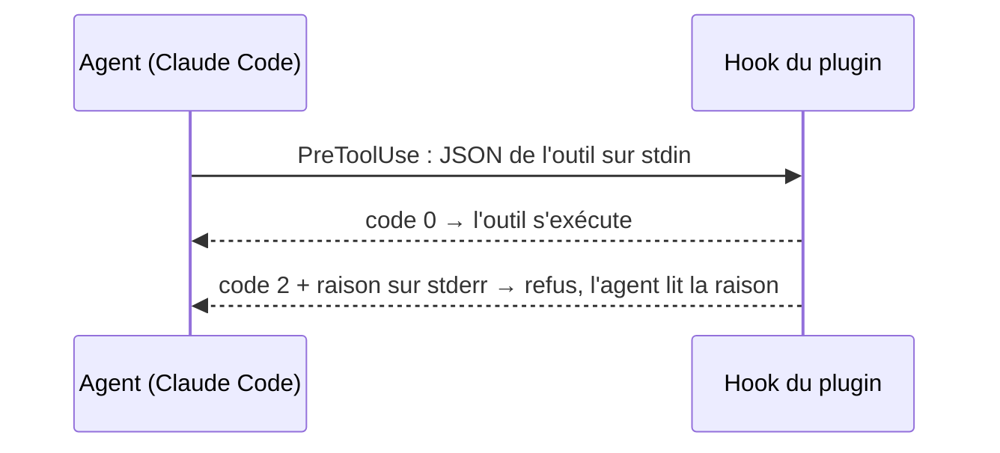

# Plugin Claude Code et hooks

## En une phrase

Un **plugin** Claude Code est un dossier que Claude Code charge tel quel ; celui de jam porte des **hooks**, des commandes que Claude Code lance à des moments fixés (démarrage de session, envoi d'un message, avant un outil) et qui peuvent refuser l'action en cours.

## Le problème

Une règle écrite dans une consigne ou dans la mémoire d'un agent dépend de sa bonne volonté. Le coordinateur devait ne produire aucun livrable : la règle était écrite, et elle a été enfreinte deux fois ([RET-005](../specs/RETOURS.md), [ADR 0012](../decisions/0012-coordinateur-role-garde-fous-hook.md)). Un hook ne se négocie pas : il lit l'action avant qu'elle ait lieu et la refuse s'il le faut, quoi que l'agent ait « compris ».

Ces hooks vivaient dans les réglages d'un poste de travail, hors de tout repo, sans tests versionnés. Le plugin les met dans le repo de jam ([ADR 0016](../decisions/0016-kit-de-methode.md)) : ils sont relus, testés en CI, et installés pareil sur chaque poste.

## Comment ça marche

- **Le plugin** : `.claude-plugin/plugin.json` (nom `jam`, sans version : il est chargé en place depuis le clone) et `.claude-plugin/marketplace.json`, une marketplace locale dont le seul plugin est la racine du repo (`"source": "."`). Installé une fois pour tout le poste, il se met à jour par le `git pull` de `main`. Pour essayer une branche : `claude --plugin-dir <worktree>`, qui remplace le plugin installé pour cette seule session.
- **Le câblage** : `hooks/hooks.json`. Chaque commande a la forme `python3 "${CLAUDE_PLUGIN_ROOT}/hooks/<hook>.py"` ; Claude Code remplace la variable par la racine du plugin.
- **Les quatre hooks** (`hooks/`), en Python, avec la seule bibliothèque standard :
  - `guard_outbound.py` (`PreToolUse` `Bash`) : la garde de sortie unique. Elle refuse `git commit`, `git push` et toute commande `gh` absente d'une liste de lectures (refus par défaut), sauf si le dernier message du mainteneur dans la session est un accord ;
  - `guard_coordinator.py` (`PreToolUse` `Edit|Write|NotebookEdit|Bash`) : si `JAM_ROLE=coordinateur`, elle refuse toute écriture de fichier hors mémoire, plan et dossiers temporaires de session ;
  - `git_context.py` (`UserPromptSubmit`) : une ligne d'état git ajoutée à chaque message ;
  - `session_start_recap.py` (`SessionStart`) : un récapitulatif git, et dans Orca la carte, le terminal, le rôle et les autres agents du worktree. Quand le repo a une fiche (`docs/methode.md`), une ligne « Méthode » donne la fiche, puis le `process/README.md` et le dossier `roles/` **du plugin qui exécute le hook**, en chemins absolus déduits de l'emplacement du hook. Elle ne désigne jamais un `process/` du repo : dans un worktree de jam, qui est le repo du plugin, les copies en cours de modification restent inertes jusqu'au merge. Sans fiche, pas de ligne.
- **La CLI Orca** passe par un seul module, `scripts/orca_cli.py`, utilisé par le récapitulatif, la veille et le lancement. Il cherche le binaire dans `JAM_ORCA_BIN`, puis dans le `PATH`, puis à l'emplacement standard de l'app sur macOS. Les scripts : `scripts/watch_cards.py`, qui attend qu'une carte demande le coordinateur ou ne soit plus tenue, `scripts/launch_task.py`, qui lance un rôle sous les plafonds d'agents, et `scripts/maintainer_time.py`, qui estime le temps du mainteneur sur une tâche ([veille et mesure](veille-et-mesure.md)).
- **La marque** : chaque message d'un hook ou d'un script commence par `[jam]`.
- **Les tests** lancent chaque hook comme Claude Code le fait (JSON sur stdin, verdict par le code de sortie) ; un faux binaire Orca écrit par le test sert des sorties d'exemple (`scripts/fixtures/`). `python3 -m unittest` à la racine les trouve tous.

## Les pièges

- **Hooks en double pendant la transition** : tant que les hooks du poste restent câblés, ils tournent en même temps que ceux du plugin. Deux récapitulatifs s'affichent, deux refus peuvent tomber : seul ce qui porte `[jam]` vient du plugin.
- **`CLAUDE_PLUGIN_ROOT` n'existe pas pour l'outil Bash** : un hook la reçoit, un agent qui lance une commande non. Un agent ne trouve donc pas seul les scripts du plugin ; il faut lui donner leur chemin.
- **L'accord est lu sur le seul dernier message du mainteneur** : un « ok » donné trois messages plus tôt ne vaut plus. Un feu vert lu sur une carte Orca arrive comme résultat d'outil, et ne compte pas. Après une compaction du contexte, Claude Code écrit le résumé de la session comme un message « utilisateur » (marqué `isCompactSummary` et `isVisibleInTranscriptOnly`) qui finit par « Continue the conversation… » : sans filtre, ce « continue » ouvrirait la garde jusqu'au vrai message suivant ; la garde l'écarte donc, comme les messages `isMeta`. De même, une commande `!` du mainteneur s'écrit dans la session comme des messages « utilisateur » : la commande (`<bash-input>`) puis sa sortie (`<bash-stdout>`, `<bash-stderr>`). Ce n'est pas sa parole : `! git status` affiche « nothing to commit », et « commit » est un mot d'accord. La garde écarte ces messages, ainsi que la sortie d'une commande `/` (`<local-command-stdout>`, `<local-command-stderr>`), et lit l'accord sur le message tapé avant. Une commande `/` elle-même (`<command-name>`) compte au contraire comme un message du mainteneur, réduit à ses arguments : un skill lancé par `/` ouvre un tour de l'agent, et l'accord donné avant ne vaut plus pour ce tour. Le nom de la commande ne compte pas (`/merge` n'est pas un accord) ; `/simplify ok commit`, si. Contrepartie : après une commande locale comme `/model`, qui n'ouvre pas de tour, une écriture attend le message suivant. À l'inverse, un texte envoyé par `orca terminal send` compte comme un message du mainteneur : rien ne distingue un relais d'une saisie. Et le vocabulaire d'accord est large (« continue », « suite », « lance » passent). Comme il contient les verbes eux-mêmes, un message qui porte une négation (« ne … pas », « n'… pas », « pas de », « pas d' », « non », « attends », « stop », « jamais ») vaut refus, même avec un mot d'accord : « ne commit pas » et « pas d'accord » ne passent pas. Peu importent la casse, un retour à la ligne entre « ne » et « pas », et l'apostrophe, droite, typographique ou perdue : un relais envoyé par `orca terminal send` perd ses apostrophes (« ce n est pas »). Contrepartie, côté sûr : une phrase sans intention de refus est refusée aussi (« pas de souci, go », « ok, non bloquant »), et le mainteneur reformule ; un relais du coordinateur qui contient une négation (« ce n'est pas le feu vert merge ») ne vaut pas accord.
- **Un hook est un garde-fou, pas un bac à sable** : il lit la commande telle qu'écrite. Une commande construite par une variable, un `eval` ou un script échappe à la garde ; chaque hook liste ce qu'il ne couvre pas dans sa docstring.
- **Une entrée illisible laisse passer, un transcript illisible bloque** : un hook qui plante ne doit pas bloquer toute la session, mais un accord qu'on ne peut pas vérifier n'est pas un accord. Un hook qui plante sort en code 1, que Claude Code traite comme une erreur sans refus : la commande s'exécute. La garde de sortie rattrape donc son propre plantage, et refuse dès qu'elle a reconnu une écriture.
- **Le dossier courant n'est pas celui du plugin** : Claude Code lance les hooks depuis le dossier de la session. Le récapitulatif trouve `scripts/orca_cli.py` depuis son propre emplacement.

## Pour aller plus loin

- [Plugins Claude Code](https://code.claude.com/docs/en/plugins) et [référence des marketplaces](https://code.claude.com/docs/en/plugins/marketplace-reference)
- [Hooks Claude Code](https://code.claude.com/docs/en/hooks)
- [ADR 0012](../decisions/0012-coordinateur-role-garde-fous-hook.md) (garde du coordinateur), [ADR 0016](../decisions/0016-kit-de-methode.md) (le kit)
- Plan de la tâche : [`docs/plans/22-repo-devient-le-kit.md`](../plans/22-repo-devient-le-kit.md)
