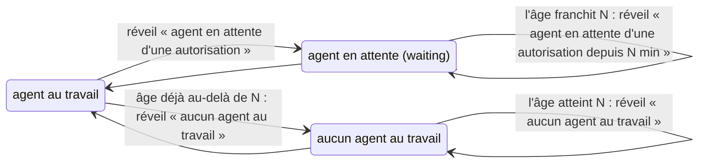

# Veille sur transitions et mesure du temps du mainteneur

## En une phrase

Deux scripts du plugin observent sans rien tenir en mémoire durable : la **veille** réveille le coordinateur quand l'état d'une carte ou de ses agents *change*, une fois par épisode ; la **mesure** reconstruit après coup le temps passé par le mainteneur sur une tâche, d'après ce qu'il a tapé.

## Le problème

- **Veille** : la carte Orca est tenue par l'orchestrateur de tâche. Bloqué sur une invite d'autorisation, ou arrêté, il ne peut plus la tenir : la carte reste `▶` et rien ne bouge. Le coordinateur devait le remarquer à la main (« une carte longtemps `in-progress` »), ce qu'il ne faisait pas. Orca, lui, connaît l'état de chaque agent (`orca worktree ps`).
- **Mesure** : la méthode n'a qu'une mesure, le temps du mainteneur par tâche (FR-055). Personne ne la chronomètre ; une estimation au jugé ne vaut pas une mesure.

## Comment ça marche

**Veille** (`scripts/watch_cards.py`). Le script lit les cartes au lancement, puis à intervalle régulier, et compare chaque lecture à la précédente. Il ne réveille que sur une **transition**, ce qui donne « une fois par épisode » sans fichier d'état :

- *bloqué* : un agent (`paneKey`) entre dans l'ensemble des agents `waiting` de la carte ; ceux qui y sont déjà au lancement comptent comme vus ;
- *inactif* : l'âge de la carte, maintenant moins le plus récent `stateStartedAt` de ses agents (millisecondes entières), atteint N minutes (`--idle-minutes`, 10 par défaut). Une carte déjà au-delà de N à sa première lecture inactive réveille aussitôt ; seule la lecture de lancement compte cet état comme vu. Sans agent ni date lisible, l'âge part de la première lecture du script ;
- *toujours bloqué* : un agent `waiting` (dans `state` ou dans `mainAgent.state`, même si l'autre champ dit `working`) n'est pas au travail, donc sa carte franchit N aussi, N minutes après le début de l'attente. Ce second réveil porte le nom « agent en attente d'une autorisation depuis N min » : le coordinateur prévient le mainteneur, et ne relance pas un orchestrateur qui attend seulement une réponse.

Seules les cartes `▶`, hors worktree principal et cartes `completed`, sont visées : `⏸` et `⛔` attendent déjà le mainteneur. Quand le commentaire change au même relevé, le réveil garde le nom de la raison de l'agent : la veille relancée la compterait comme vue, et ne la nommerait plus.

**Mesure** (`scripts/maintainer_time.py`). Le script lit les transcripts de Claude Code (un fichier JSONL par session) et ne garde que les sessions du coordinateur, démarrées dans le worktree principal, puis les messages du mainteneur, triés par la même fonction que la garde de sortie (`maintainer_words`, dans `hooks/guard_outbound.py`). Les sessions du worktree de la tâche ne sont pas lues : s'y mêlent des textes d'agents (briefs, relais passés par une variable shell, blocs collés), qu'aucune lecture ne distingue des mots du mainteneur. Le nom du dossier de `--worktree` sert seulement à rattacher un message à la tâche. Un transcript d'un autre dossier est écarté dès son premier évènement, un transcript illisible (lien symbolique cassé, droits, fichier disparu) ou sans `cwd` est ignoré, et le rapport donne le nombre de sessions du worktree principal lues, pour qu'un chemin erroné ne passe pas pour « 0 min » ; il finit sur ce qu'il ne compte pas. Un message du coordinateur compte s'il nomme la tâche (`#<n>` ou le nom du worktree), ou si l'un des textes de son dernier tour la nomme : tout le tour, que Claude Code écrit en un évènement par bloc (« texte, appel d'outil, texte »). Un tour s'ouvre sur un message du mainteneur ou sur une notification de tâche de fond, comme le réveil de la veille. Les messages à moins de 10 min l'un de l'autre forment un **moment**, qui vaut sa durée plus 3 min de lecture. La sortie ne contient que des comptes et des heures.

## Les pièges

- **Une relance remet les compteurs à zéro** : un agent toujours bloqué ne réveille plus comme nouvel agent bloqué, mais une fois encore si son attente atteint N minutes, et une carte sans agent réveille de nouveau N minutes après. Le coordinateur clôt l'épisode en relançant l'orchestrateur ou en passant la carte en `⛔`.
- **Un agent bloqué entre la sortie de la veille et son relancement n'est signalé qu'au bout de N minutes d'attente** : au relancement, il compte comme vu. D'où la veille relancée aussitôt, avant de traiter le réveil.
- **La fenêtre d'autorisation du système** (macOS) laisse l'agent `working` : la veille ne la voit pas (Q-059).
- **La mesure est une estimation** : la recette du mainteneur, faite dans une session du worktree de la tâche, n'est pas comptée, ni un feu vert tapé là ; un « ok » qui suit un résumé de plusieurs tâches compte pour chacune ; un message qui ne nomme aucune tâche est perdu. Le temps de lecture entre deux messages espacés de plus de 10 min n'est pas compté.
- **Deux lectures d'un transcript divergeraient** : d'où la fonction partagée avec la garde de sortie, plutôt qu'une copie.

## Pour aller plus loin

- [process/README.md](../../process/README.md), « Carte, feux verts et veille » et « Mesure »
- [Plugin Claude Code et hooks](plugin-et-hooks.md)
- Plan de la tâche : [`docs/plans/23-process-elague.md`](../plans/23-process-elague.md)
