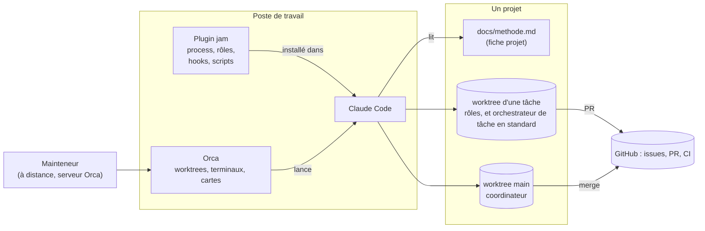

# 02 — Architecture

> Statut : réécrite le 2026-10-11 pour le kit ([ADR 0016](../decisions/0016-kit-de-methode.md), [ADR 0017](../decisions/0017-coordinateur-main-poste-de-travail.md)). L'architecture de l'app (Electron, cœur séparé, SQLite) se lit au tag `app-electron`.

## Vue d'ensemble

## Composants

| Composant | Rôle |
|---|---|
| `process/` | Référence de la méthode, élaguée : étapes, niveaux de tâche, feux verts et leur relais, carte Orca, garde-fous, plafond d'agents global ; gabarit de la fiche projet |
| `roles/` | Les sept profils : mission, permissions (options de la CLI, [ADR 0009](../decisions/0009-permissions-par-role.md)), règles. Génériques : ce qui dépend du projet vient de sa fiche |
| `hooks/` | Garde du coordinateur ([ADR 0012](../decisions/0012-coordinateur-role-garde-fous-hook.md)), garde de sortie unique (commit, push, merge, écritures `gh`), reprise de contexte au démarrage, contrôle d'état git à chaque message. Avec leurs tests, lancés en CI |
| `scripts/` | Veille des cartes d'un projet, lancement d'une tâche. Ils pilotent Orca par sa CLI |
| Fiche projet | `docs/methode.md` dans chaque projet : niveau par défaut, commande de test, grille de relecture, recette, sens d'un merge, plafond d'agents du projet |

`docs/` reste la documentation de jam lui-même. jam suit sa propre méthode : il a sa fiche, au niveau *léger*. Son `README.md` est la page publique de la méthode.

## Où tourne quoi

- **Poste de travail** : une machine dédiée, sous macOS. Orca, Claude Code, `gh` et le plugin y sont installés. Les agents s'y lancent par Orca, jamais par SSH (ADR 0017).
- **Un projet** : un repo cloné sur le poste, ouvert dans Orca. Son coordinateur tourne dans un terminal Orca du worktree `main` ; chaque tâche a son worktree et ses rôles, plus un orchestrateur de tâche au niveau *standard*.
- **Le mainteneur** pilote Orca à distance, par le serveur Orca distant. Il valide sur l'écran du poste les fenêtres d'autorisation du système.

## Stack

| Couche | Choix |
|---|---|
| Distribution | Plugin Claude Code, servi par une marketplace locale sur le clone de jam (`.claude-plugin/`), installé pour tout le poste et mis à jour par le `git pull` de `main` ([Q-055](OPEN-QUESTIONS.md)) |
| Docs de la méthode | Markdown |
| Hooks et scripts | Python 3 (bibliothèque standard) ou shell, sans dépendance à installer ; tests `unittest`, lancés en CI |
| Pilotage | CLI `orca` (sortie JSON), `git`, `gh` |
| Agents | Claude Code, en sessions Orca ; rôles en terminaux ou en sous-agents : ouvert ([Q-054](OPEN-QUESTIONS.md)) |

Le code Electron (`apps/`, `packages/`) et son outillage (pnpm, Vitest) ont été retirés par la première issue du jalon K1 (#22).
